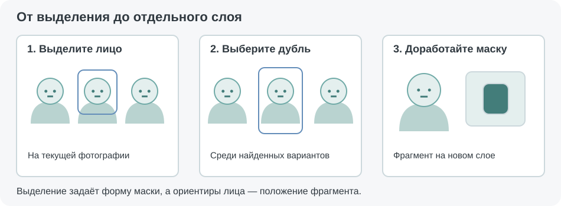
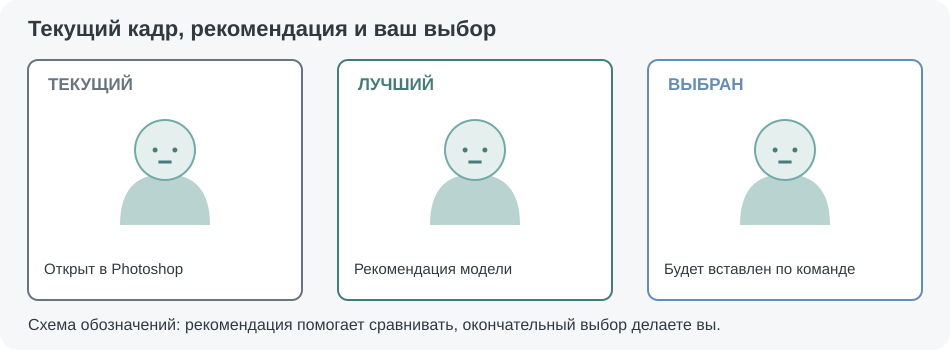
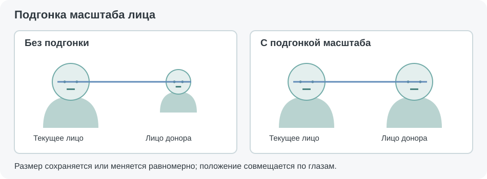
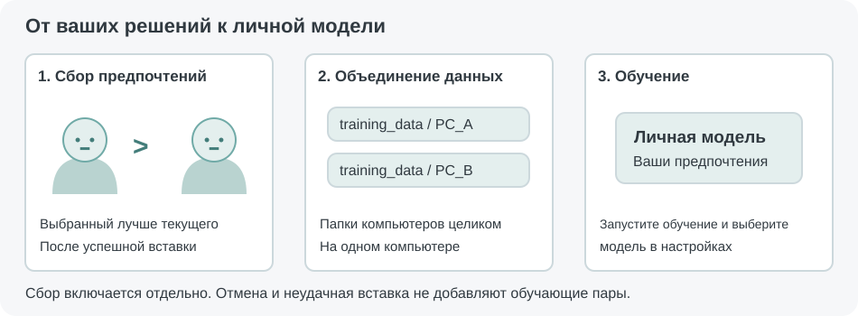

# Group Face Picker для Photoshop

**Group Face Picker** помогает заменить лицо ребёнка на групповой фотографии удачным фрагментом из другого дубля. Вы выделяете нужное лицо в Photoshop, а программа находит того же ребёнка на соседних снимках и показывает варианты для сравнения. После выбора фрагмент вставляется отдельным слоем с маской по вашему выделению.

По умолчанию размер лица сохраняется, а положение совмещается по глазам. Если между дублями человек немного приблизился к камере или изменил позу, можно включить подгонку масштаба и дополнительные способы совмещения.

## Установка и первый запуск

Программа рассчитана на Windows 10/11 x64 и настольный Photoshop с поддержкой JSX. Для RAW используется Adobe Camera Raw. Видеокарта NVIDIA может ускорить анализ, но не обязательна: программа умеет работать на процессоре.

Распакуйте архив в отдельную папку и запустите `install.bat`. Выберите **Normal secure mode** и дождитесь сообщения **Installation complete**. Если Kaspersky мешает загрузке файлов, повторите установку в режиме **Kaspersky compatibility mode**. Для первой установки нужен интернет и несколько гигабайт свободного места; при установке компонентов NVIDIA желательно оставить около 8–10 ГБ с запасом.

Установщик подготовит приватный Python, зависимости и модели. Системный Python, CUDA Toolkit и cuDNN отдельно устанавливать обычно не требуется. Среда программы находится в её собственной папке.

После установки запустите `run_server.bat` и оставьте окно сервера открытым. Затем в Photoshop выберите **Файл → Сценарии → Обзор…** и укажите `Group Face Picker.jsx`. Для постоянного доступа JSX можно скопировать в папку `Presets\Scripts` вашей версии Photoshop и перезапустить Photoshop. Остальную папку программы сохраните на месте: в ней работает сервер.

После первого успешного подключения Photoshop запоминает путь к `run_server.bat` и при следующих запусках пробует сам запустить недоступный локальный сервер. Если папку программы перенесли, один раз запустите BAT из нового расположения вручную.

Используемые предобученные модели имеют собственные условия лицензирования. В частности, для коммерческого применения `buffalo_l` необходимо учитывать ограничения и условия лицензии модели, указанные проектом [InsightFace](https://github.com/deepinsight/insightface).

## Поиск и выбор лица

Откройте групповую фотографию, которая уже существует на диске, и выделите лицо нужного ребёнка. Для этого подходит прямоугольное выделение или выделение сложной формы, подготовленное через Quick Mask. Важно, чтобы выбранная область однозначно указывала на одного человека.

Запустите `Group Face Picker.jsx`. При первом обращении программа проанализирует фотографии группы; при следующих заменах сможет использовать сохранённые результаты. После поиска откроется окно с найденными дублями.

Плашка **«ТЕКУЩИЙ»** отмечает открытый снимок, а **«ЛУЧШИЙ»** — рекомендацию модели. Синяя рамка показывает выбранный вариант. Текущий кадр нужен для сравнения: вставить его в самого себя нельзя. Рекомендация тоже не запускает вставку автоматически — окончательный выбор остаётся за вами.

Выберите превью щелчком мыши или стрелками клавиатуры. Для вставки нажмите **Enter**, кнопку **«Вставить выбранное»** или дважды щёлкните по нужному превью. Под изображениями показывается степень сходства, а подсказка при наведении помогает узнать имя исходного файла.

Список **«Порядок»** позволяет расположить кадры по именам файлов, похожести или удачности. Похожесть помогает найти того же человека, а удачность — сравнить выражение лица по выбранной модели. Если оценок модели нет, используется порядок файлов. Переключение порядка не запускает новый поиск.

Ползунок **«Размер»** меняет превью от 64 до 320 пикселей; начальное значение — 184. После отпускания ползунка окно обновляется с сохранением выбранного кадра. Если все варианты не помещаются на экране, доступны страницы.

## Как вставляется фрагмент

В обычном режиме фотография-донор совмещается с текущим кадром по глазам без изменения масштаба и без поворота. Вставленный фрагмент получает маску по исходному выделению, включая сложную форму Quick Mask. После вставки маску можно доработать обычными инструментами Photoshop.

Если размер лица между дублями отличается, включите **«Подгонять масштаб лица»** прямо в окне выбора. Настройка применяется к уже найденным вариантам и запоминается для следующего запуска. Основной ориентир для масштаба — расстояние между глазами; расстояние от глаз до рта вносит небольшую поправку, когда оба замера согласуются. Фрагмент масштабируется равномерно, без перспективной деформации.

Чтобы после уменьшения лица не осталось пустых краёв внутри маски, программа заранее выбирает исходный фрагмент достаточного размера. Итоговая область вставки по-прежнему определяется вашим выделением.

В общих настройках есть две дополнительные опции. **«Уточнять по шее и одежде»** помогает согласовать переход ниже лица, если детали одежды уверенно совпадают. При слишком разной позе или ненадёжном совпадении сохраняется совмещение по лицу. **«Разрешить небольшой поворот»** допускает коррекцию до 8° по одежде или до 5° по линии глаз. Поворот включается отдельно от подгонки масштаба; если для него не хватает изображения по краям, используется совмещение без поворота.

Исходные фотографии на диске не сохраняются поверх оригиналов. Донор, открытый скриптом, закрывается без сохранения, а у заранее открытого донора восстанавливается прежнее состояние истории. Для RAW могут создаваться недостающие XMP-файлы — об этом ниже.

## Фотографии в папке и повторный поиск

Если в папке находятся только дубли одной группы, оставьте **«Поиск границ группы»** выключенным. Тогда программа рассматривает все поддерживаемые файлы этой папки как один набор и может анализировать их параллельно.

Когда в папке подряд лежат разные группы, включите поиск границ. Открытый файл станет точкой отсчёта: сервер просмотрит соседние снимки в обе стороны и остановится после уверенной смены состава лиц. Для подтверждения границы он может проверить первые кадры соседней группы, но не добавляет их в текущий набор.

Первый анализ обычно занимает больше времени. Найденные лица, координаты и превью сохраняются в `runtime\cache`, поэтому при выборе следующего ребёнка из той же группы повторное чтение всех исходников обычно не требуется. По умолчанию кэш хранится 48 часов с последнего использования. В оперативной памяти сервер держит текущий индекс группы, а прежние наборы остаются в дисковом кэше до окончания срока хранения.

## Настройки

Чтобы сразу открыть настройки, удерживайте **Shift** при запуске JSX. В этом случае поиск и вставка не выполняются. Настройки также доступны из окна выбора лиц.

Для начала подойдут режим вычислений **«Авто»**, профиль **«Баланс — 800»** и остальные значения по умолчанию. В режиме «Авто» сервер использует доступную NVIDIA GPU и при необходимости переходит на CPU. Режим **GPU** требует работающего ускорения и сообщает об ошибке, если оно недоступно; режим **CPU** принудительно использует процессор.

| Параметр | Когда его менять |
| --- | --- |
| **Скорость / мелкие лица** | «Быстро — 640» уменьшает время анализа; «Баланс — 800» подходит для начала; «Точно — 1024» полезно, если маленькие лица теряются. Это размер входа детектора для всего кадра, а не размер превью лица. |
| **Потоки анализа: 1–4** | Больше потоков может ускорить первый анализ, но увеличивает нагрузку. Начните с 2. |
| **Потоки превью: 1–8** | Влияют на подготовку изображений для окна выбора. Увеличивать стоит, если именно этот этап заметно задерживается. |
| **Порог совпадения** | Если нужное лицо пропускается, можно немного снизить порог; если появляются чужие лица — повысить. Начальное значение — 0,28. |
| **Источник рекомендации** | Можно отключить рекомендацию, выбрать публичную FBP, свою обученную модель или их сочетание. |

Личная модель подключается из `personal_model/personal_preference.onnx`. Если она отсутствует или не загрузилась, поиск дублей продолжает работать: личная рекомендация будет недоступна, а в комбинированном режиме может использоваться публичная FBP.

Для локальной работы используются адрес **127.0.0.1** и порт **6420**. Если сервер недоступен, окно настроек сохраняет только параметры подключения; остальные настройки следует применить после восстановления связи. Рабочий конфиг сервера находится в `gfp_config.json` рядом с `group_face_server.py`, а клиентские настройки и запомненный путь запуска — в папке настроек Photoshop.

## RAW, Camera Raw и другие форматы

Поддерживаются JPEG, PNG, TIFF, BMP, WebP, PSD и распространённые RAW: CR2, CR3, NEF, ARW, DNG, RAF, RW2 и ORF. Для быстрого поиска в RAW программа использует встроенное превью, а выбранного донора Photoshop открывает из оригинала через Camera Raw. Координаты пересчитываются с учётом фактического размера открытого документа.

Если для текущего RAW доступны настройки Camera Raw, программа старается передать тот же базовый набор другим RAW группы. Источником может быть sidecar XMP или метаданные открытого документа. Создаются только недостающие `.xmp`; уже существующие sidecar-файлы других снимков не перезаписываются. Отдельного переключателя XMP в интерфейсе нет.

## Сбор предпочтений и личная модель

Если хотите обучить программу своим предпочтениям, включите **«Собирать статистику для обучения»** в настройках. По умолчанию сбор выключен. Данные записываются только после успешной вставки: отмена окна, выбор текущего кадра или ошибка вставки в обучающий набор не попадают.

Программа запоминает, что выбранный дубль оказался предпочтительнее текущего. Если вы явно заменили автоматически предложенный кадр другим и вставили его, сохраняется и это сравнение. Остальные показанные варианты автоматически проигравшими не считаются.

Данные находятся в `training_data` внутри подпапок с ID компьютеров. Для общего обучения скопируйте эти подпапки целиком на один компьютер и запустите `train_personal_model.bat`. Первый запуск подготовит отдельное окружение обучения; рабочая среда сервера при этом сохраняется.

После обучения выберите **«Моя обученная модель»** или комбинированный вариант в настройках. Такая модель предназначена для сравнения дублей одного человека по вашим предпочтениям. Небольшого набора достаточно для проверки процесса, но полезность рекомендации нужно оценивать по отчёту и реальной работе.

Подробный порядок сбора, объединения данных, обучения и чтения отчёта приведён в [инструкции по личной модели](docs/TRAINING.md).

## Обновление, перенос и решение проблем

При обновлении заменяйте JSX и Python-сервер вместе, сохраняя свои настройки, `training_data` и `personal_model`. Затем перезапустите `run_server.bat`: оставшийся в памяти старый сервер может сообщить о несовпадении версий. После переноса папки BAT проверяет пути окружения и при необходимости исправляет их. Если среда отсутствует или повреждена, повторите `install.bat`.

Для прерывания работы используйте **Esc** во время прогресса Photoshop. Скрипт прекращает ожидание и, когда это поддерживается текущим этапом, отправляет серверу отмену. Уже начатое вычисление одного кадра может завершиться прежде, чем обработка остановится. Отмена ожидания запуска не закрывает сам сервер.

Если сервер не отвечает, сначала запустите `run_server.bat` вручную и проверьте сообщение в его окне. Если проблема связана с GPU, попробуйте режим «Авто» или CPU. Подробности работы и ошибок сохраняются в `runtime\logs\group-face-server.log`; приложите соответствующий фрагмент при обращении за помощью.

Python-сервер можно использовать и на другом компьютере доверенной локальной сети, если настроены сетевой адрес, доступ к исходникам и разрешение Windows Firewall. Автоматический запуск предназначен для локального сервера. Протокол не использует аутентификацию, поэтому его порт не следует публиковать напрямую в интернете.

Запуск JSX можно записать в операцию Photoshop. Записывается сам вызов скрипта: служебный параметр операции не заменяет текущие настройки Group Face Picker.

История исправлений и технические заметки находятся в [CHANGELOG.md](CHANGELOG.md).
